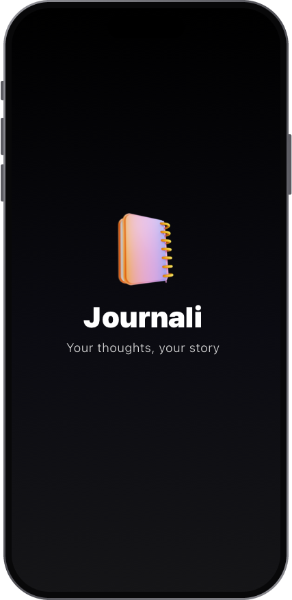
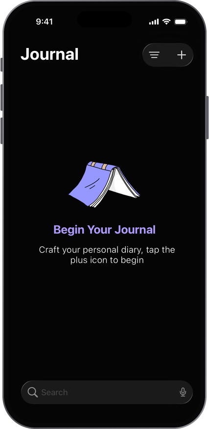
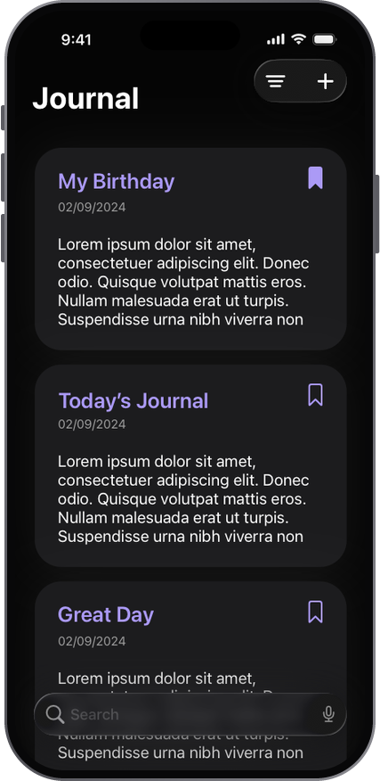
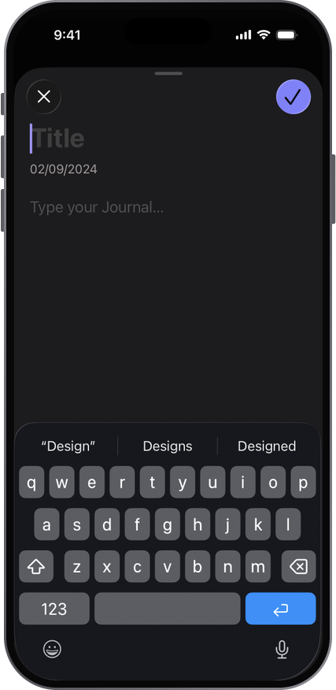

# 📔 Journali


**Your thoughts, your story.**

Journali is a simple journaling app for iPhone where you can write, bookmark, search, and sort your personal journals.

## 📝 Description

Journali is your personal digital diary. Write a journal with a title and text, come back later to edit it, bookmark your favorites, and find any entry with search or sorting. Your journals are saved on the device, so they are still there when you reopen the app.

The app was built with SwiftUI as part of a 10-day challenge, following a hi-fi design from Sketch. The code is organized with the MVVM pattern: Models describe the data, Views show the screens, and the ViewModel handles the logic.

## ✨ Main Features

- 🌅 Splash screen that fades into the main page
- 📭 Empty state when there are no journals yet
- ✍️ Add a new journal with a title and text
- 📝 Edit a journal by tapping its card
- 🔖 Bookmark and un-bookmark journals
- 🔀 Sort by bookmark or by entry date
- 🔍 Search journals by title or content
- 🗑️ Swipe a card to delete, with a confirmation alert
- ⚠️ "Discard changes" alert when closing the editor after editing
- 💾 Journals are saved on the device
- 🫧 Liquid Glass buttons and search bar

## ✨ Added Features
### 🔍 No Results
A "No Results" message appears when no journal matches your search, so the screen never looks broken or empty.
### 💾 Local Data Persistence
Journals are saved on the device as a JSON file, so your entries are still there after closing and reopening the app.
### 🛡️ Protection From Losing Changes
If you have unsaved changes, dragging the sheet down will not close it by accident. You have to use the ✕ button and choose Discard Changes or Keep Editing.
### ⌨️ Smooth Keyboard Flow
The keyboard opens right away with the cursor in the right place. Pressing Return on the title moves you to the journal text, and scrolling down hides the keyboard.
### 🧹 Clear Search Button
A small ✕ appears in the search bar while you type, so you can clear your search in one tap.
### 🧠 Smarter Search
Search ignores capital letters and looks in both the title and the text of every journal.


## 📱 Screenshots

| Splash | Empty State | Main Page | New Journal |
|:---:|:---:|:---:|:---:|
|  |  |  |  |

## 🛠️ Tech Stack


- **MVVM** design pattern
- **SF Pro** font and **SF Symbols** icons
- **Codable** and JSON for saving data

## 🗂️ Project Structure

```
Journali
├── Models        Journal, SortOption
├── Views         SplashView, RootView, MainPageView,
│                 EmptyStateView, JournalCardView, JournalEditorView
├── ViewModels    JournalViewModel
├── Extensions    Color+App
└── MyApp.swift
```

## 🤝 Contributing

Contributions are welcome! If you would like to add features, improve the UI, or fix bugs, feel free to open a pull request.

## 📬 Contact

Made with ❤️ by Nawaris Alotaibi • GitHub: [@nawarisbader-coder](https://github.com/nawarisbader-coder)
• LinkedIn: @Nawaris Alotaibi
